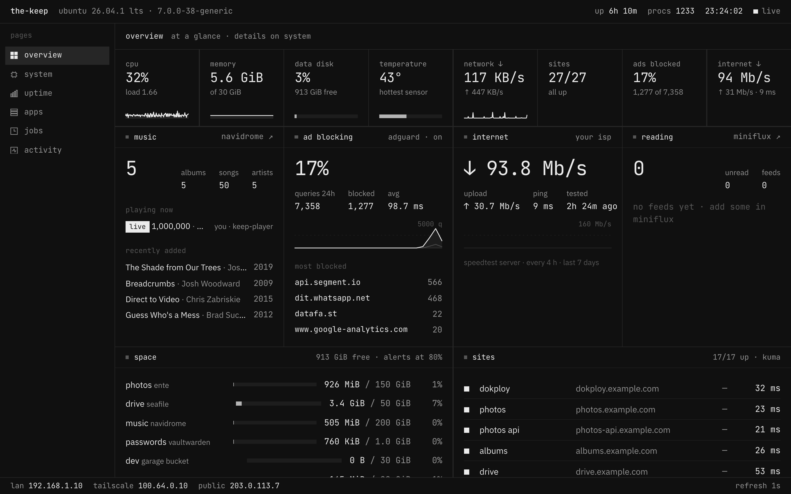
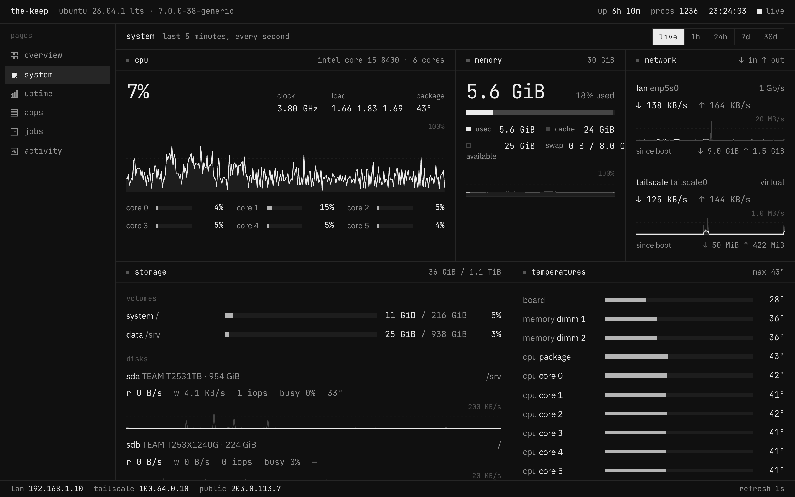
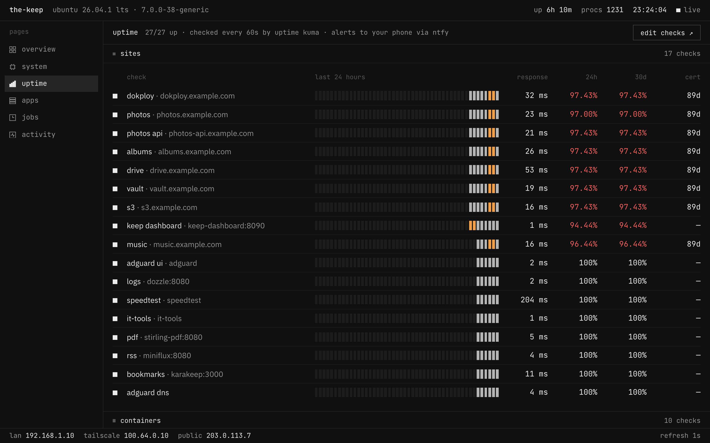
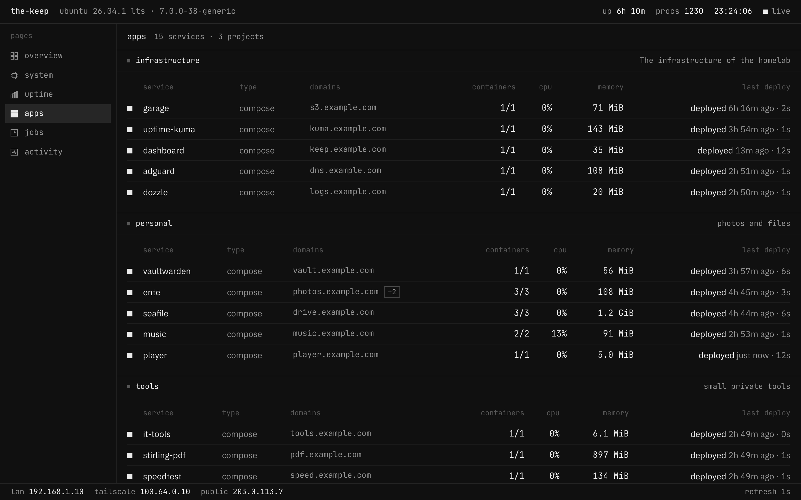
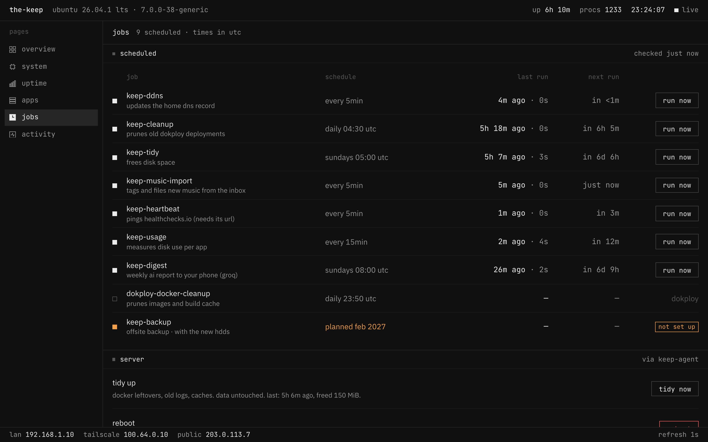
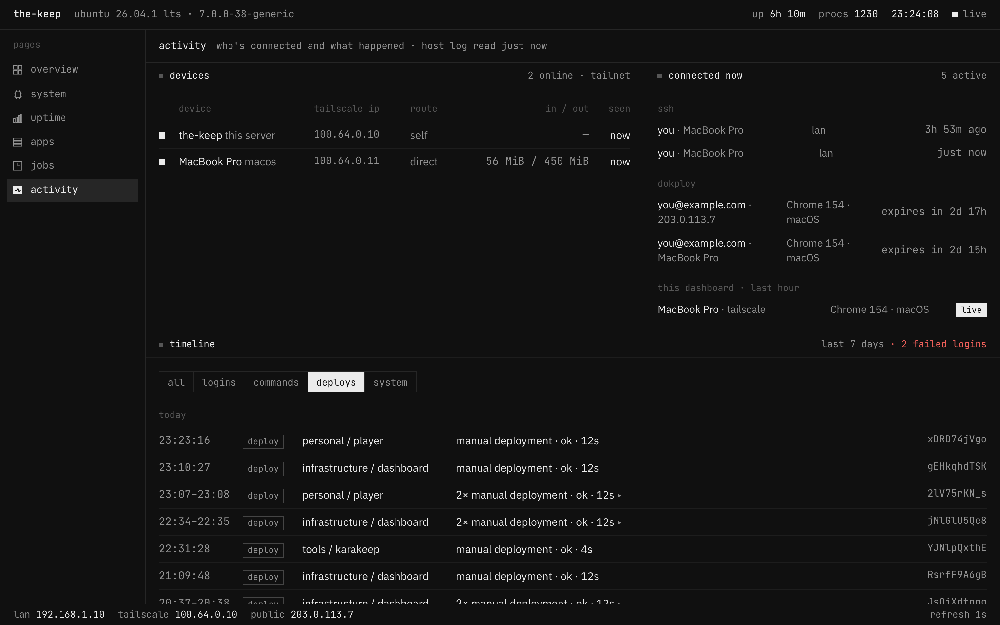

<div align="center">

# keep dashboard

**A monochrome, single-page dashboard for one self-hosted box.**
CPU to containers, uptime to ad blocking, jobs you can run and a log of who logged in — on one screen, refreshed every second.




</div>

## What it shows

| Page | |
|---|---|
| **overview** | Eight tiles (cpu, memory, data disk, temperature, network, sites up, ads blocked, internet speed), then music, ad blocking, internet and reading panels, space per app against its limit, and your public sites. |
| **system** | CPU per core with clock and load, memory, network per interface, volumes and disks (read/write, iops, busy, temperature), every temperature sensor, every container with CPU and memory. Graphs for live / 1 h / 24 h / 7 d / 30 d. |
| **uptime** | Every Uptime Kuma check: status, a 24-hour strip of half-hour bars, response time, 24 h and 30 d uptime, days left on the TLS certificate. |
| **apps** | Every Dokploy project and service: containers, CPU, memory, domains, last deploy, plus a structured log of what the nightly cleanup removed. |
| **jobs** | Scheduled host jobs with last result and next run, a *run now* button for each, and *tidy* / *reboot* buttons. |
| **activity** | Tailnet devices, who's connected right now (SSH, Dokploy, this dashboard), and a 7-day timeline of logins, sudo commands, deploys, cleanups and reboots, folded into sessions. |

| system | uptime |
|---|---|
|  |  |
| **apps** | **jobs** |
|  |  |



## Design

Black and white only, taken from the Zed *Monochrome* theme and a matching Ghostty palette: square corners,
hairline borders, IBM Plex Sans for text and JetBrains Mono for numbers. The **only colors are orange and
red**, and they mean one thing: something is close to (orange) or at (red) its limit. Light mode follows the OS.

## How it works

```
browser ──SSE 1 s──▶ Bun server (container) ──reads──▶ host /proc, /sys, docker (read-only socket proxy)
                          │                         ──calls──▶ Garage, Dokploy, Kuma, AdGuard, Navidrome, Miniflux
                          │                         ──reads──▶ Speedtest Tracker's SQLite (ro)
                          └── /data (rw) ◀──writes── host/keep-agent  (jobs.json, activity.json, actions)
```

- One Bun process collects everything and streams a snapshot every second over Server-Sent Events; long-term
  history (1-minute averages and peaks, 31 days) lives in SQLite.
- The container never runs commands on the host. Buttons drop a request file into `/data/requests/`; the
  **host agent** (`host/keep-agent.py`, a systemd path unit) accepts only `reboot`, `tidy` and `run:<known job>`,
  and refuses everything else. Requests need an `x-keep-action` header, so other sites can't trigger them.
- Every integration is optional: a panel shows "not reachable" or hides when its service isn't configured.

## Run it

The dashboard is meant to sit **behind your VPN** (it shows a lot about your box and has buttons that reboot
it). The reference setup is Dokploy + Traefik with a Tailscale-only route.

1. Copy `docker-compose.example.yml`, set the environment variables you need (table below) and deploy it.
2. Install the host side (as root):
   ```sh
   install -m 755 host/keep-agent.py /usr/local/bin/keep-agent
   install -m 755 host/keep-cleanup.py /usr/local/bin/keep-cleanup   # Dokploy only
   install -m 755 host/keep-tidy.py /usr/local/bin/keep-tidy
   install -m 700 host/dk /usr/local/bin/dk                          # Dokploy API helper, reads /etc/dokploy-api.env
   cp host/systemd/* /etc/systemd/system/ && systemctl daemon-reload
   systemctl enable --now keep-agent.path keep-agent-status.timer keep-cleanup.timer keep-tidy.timer
   ```
3. Optional: list your own systemd timers on the jobs page in `/srv/keep-dashboard/agent.json`, and apps that sleep
   when idle under `switches` to get start/stop buttons:
   `{"switches": {"minecraft": {"description": "game server", "filters": ["label=com.docker.compose.service=minecraft"]}}}`

### Security

- **VPN only, and only through your proxy.** Set `KEEP_GATE` to a long random value and have the VPN-only route add
  `X-Keep-Gate: <value>` (Traefik: a `headers.customRequestHeaders` middleware, which also overwrites a value a
  client sends). Without it every API call is refused, so other containers on the same Docker network can't read
  the dashboard or press its buttons. `/healthz` stays open for uptime checks.
- **No Docker socket in the container.** Docker is read through `docker-proxy/`, which forwards only
  `GET /containers/json` (not inspect, which would show other containers' secrets), on a network only the dashboard
  shares.
- **Buttons only ask.** The host agent decides: it accepts `reboot`, `tidy` and known jobs, refuses anything else.

### Configuration

| Variable | Default | |
|---|---|---|
| `MOUNTS` | `system=/:/` | `label=hostPath:containerPath` pairs; the container path is any directory on that filesystem |
| `NET_IFACES` | — | `enp5s0=lan,tailscale0=tailscale` |
| `SERVICES` | — | `name=url` quick checks (used when Kuma isn't configured) |
| `DDNS_HOST` | — | hostname whose A record should match your public IP |
| `GARAGE_ADMIN_URL` | — | `http://garage:3903`; admin token read from `GARAGE_CONFIG` |
| `DOKPLOY_URL`, `DOKPLOY_PUBLIC_URL` | — | Dokploy API (key from `DOKPLOY_ENV`) and the link base for services |
| `KUMA_URL` | — | Uptime Kuma, read via `/metrics` with the API key in `KUMA_KEY` |
| `KUMA_PUBLIC_URL`, `NAVIDROME_PUBLIC_URL`, `MINIFLUX_PUBLIC_URL` | — | where the panels' "open ↗" links go |
| `SPEEDTEST_DB` | `/host/speedtest/database.sqlite` | Speedtest Tracker's database, mounted read-only |
| `KEEP_GATE` | — | the secret your VPN route sends as `X-Keep-Gate`; unset, the API is open to whatever reaches the port |
| `DOCKER_HOST` | — | `tcp://docker-proxy:2375`; without it, `DOCKER_SOCKET` (`/var/run/docker.sock`) |
| `DATA_DIR` | `/data` | history DB, files from the host agent, `integrations.env` (Navidrome / AdGuard / Miniflux credentials) |

Files the host side writes into `DATA_DIR` (all JSON): `jobs.json` and `activity.json` (agent), `actions.json`,
`cleanup-runs.json`, `tidy.json`, and optionally `usage.json` (per-app space against limits) and
`music-import.json` — the shapes are the `*Stats` types in [`src/shared/types.ts`](src/shared/types.ts).

## Develop

```sh
bun install
bun run typecheck
bun src/server.ts        # reads the host paths in HOST_PROC / HOST_SYS / HOST_ETC (default /host/…)
```

Deploying to your own box: put `KEEP_HOST`, `COMPOSE_ID` and `SOURCE_DIR` in a git-ignored `.deploy.env` and run
`./deploy.sh`.

## License

MIT
